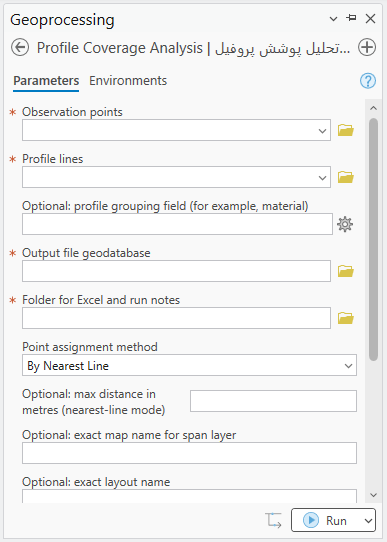

# Profile Coverage Analysis

An ArcGIS Pro Python toolbox for estimating observation coverage
along geological and mining exploration profiles.

**[Download the latest beta release](https://github.com/saasajjadi/profile-coverage-analysis/releases)**

## Tool Interface

## Features

- Match observations by profile name or nearest line
- Estimate covered and uncovered lengths and percentages
- Produce per-profile statistics and point-quality checks
- Export an Excel summary and run notes

## Important limitations

Covered is the estimated distance along a profile between the first
and last matched observations. Gaps between observations are included.
It does not prove continuous traversal or geological coverage.

Overlapping profiles are counted separately. Results are 2D planar
estimates. Check input geometry, point assignments, coordinate systems,
and geographic transformations before using the results.

## Requirements

- ArcGIS Pro with ArcPy
- openpyxl in the active ArcGIS Pro Python environment
- An existing writable file geodatabase and output folder

## Installation

1. Download and extract the complete release package.
2. Keep the .pyt and .pyt.xml files together, without renaming them.
3. In ArcGIS Pro, select Catalog > Toolboxes > Add Toolbox.
4. Select Profile_Coverage_Analysis.pyt.
5. Open the tool and review its parameter guidance.

## Testing status

Beta: core logic and metadata structure have been checked with
simulated ArcPy tests. Verify execution and parameter information
help in your ArcGIS Pro environment before production use.

## Terms of use

See [TERMS_OF_USE.txt](TERMS_OF_USE.txt).

## Developer

Seyed Aliakbar Sajjadi

- Email: SaSajjadi@outlook.com
- LinkedIn: https://www.linkedin.com/in/aliakbar-sajjadi/
- GitHub: https://github.com/saasajjadi
